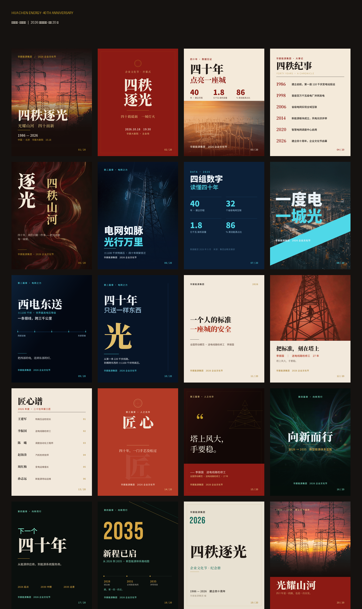

# 华宸能源 · 四秩逐光

**建企四十周年 · 2026 企业文化节 — 20 张同主题竖版活动海报**

> 主 slogan：**四秩逐光 · 光耀山河**
> 虚构主体：华宸能源集团　|　规格：1080 × 1440 px（竖版 3:4）

---

## 这套海报是什么

同一主题下 **20 种版式语言** 的完整活动物料。不是一张图换文案，而是把一个企业周年主题拆成
4 个篇章、每篇章 5 张，各自独立的版式结构（主视觉 / 中心轴 / 数据 / 编年 / 拼贴 /
夜景全幅 / 网格 / 斜切 / 图解 / 字即主角 / 极简 / 分栏 / 名录 / 徽章 / 引语 /
纪念册封面 / 收束），配合同色系推进。

## 四篇章

| 篇章 | 主题 | 主色 | 内容 |
|---|---|---|---|
| 一 · 源 | 四秩荣光 | 红金 `#8C1A14` / `#C9A227` | 主视觉、庆典开篇、数据见证、四秩纪事、汉字拼贴 |
| 二 · 光 | 电网之力 | 深蓝青 `#071426` / `#4FD8E8` | 夜景全幅、四组数字、斜切色块、图解西电东送、只送一样东西 |
| 三 · 匠 | 人之光华 | 砖红 `#B33A26` / 米白 `#F2E9DC` | 一个人的标准、把标准刻在塔上、匠心谱、匠心徽章、塔上风大 |
| 四 · 启 | 向新而行 | 墨绿金 `#0A0F0D` / `#D8A845` | 全幅、下一个四十年、2035 时间轴、纪念册封面、光耀山河 |

## 目录结构

```
output/
  posters/                        20 张成品单图 (1080×1440 PNG)
  华宸能源·四秩逐光-海报20张总览.png    4×5 拼版总览
  华宸能源·四秩逐光-企业文化节海报20张.pdf  整套合订
assets/
  clean/                          7 张主视觉源图（已裁除 AI 水印）
source/
  raw/                            7 张原始生成图（保留水印，供追溯）
```

## 素材说明

7 张主视觉为 AI 生成的能源工业题材图像，均已裁除生成水印。
`assets/clean/` 为实际入稿版本，`source/raw/` 为保留水印的原始产物。

## 设计规格

- **画布**：1080 × 1440 px
- **字体**：Noto Serif SC（标题）、Noto Sans SC（正文）、Bebas Neue（数字）
- **安全边距**：左右 84 px
- **编号**：每张右下角 `NN / 20`
- **落款**：统一出现在左下或底部居中

## 使用方式

- 印刷：PDF 已按 1080×1440 像素尺寸导出，可直接置入印前流程
- 二次编辑：源文件为可编辑设计稿（Ardot / `.ardot`），文字、图形、图层均可重组
- 单张复用：`output/posters/` 内为标准命名，按序号排列

---

## 20 张总览



---

© 2026 华宸能源集团（虚构示例项目）· 企业文化节视觉物料
